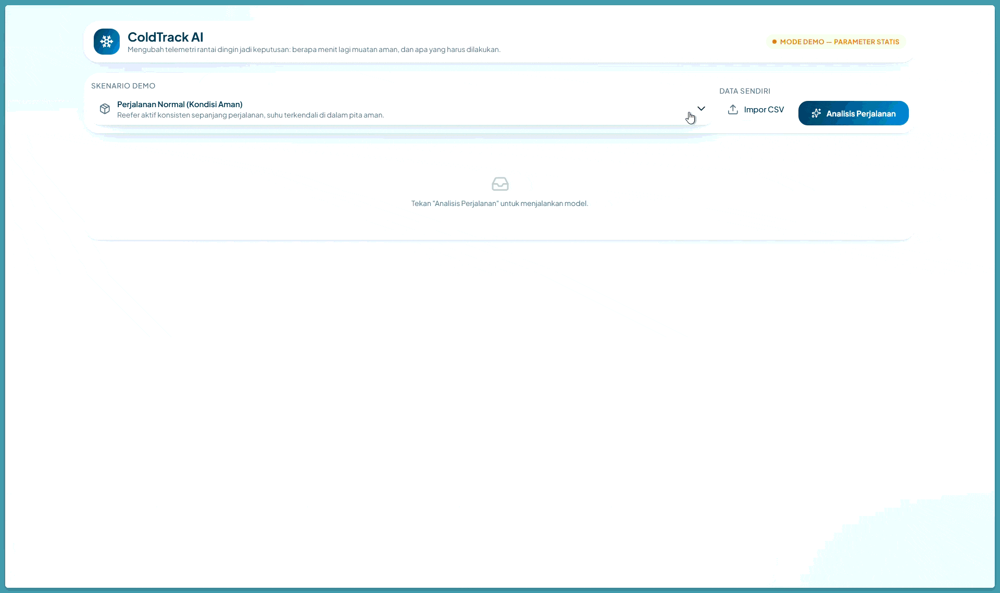

# ColdTrack AI

Sistem prediksi dini kegagalan rantai dingin (cold chain) berbasis AI, dibangun untuk COMPFEST 18 AI Innovation Challenge — kategori Smart Logistics.



*Alur demo: pilih salah satu dari lima skenario telemetri, klik "Analisis Perjalanan", lalu sistem
menampilkan status, Time-to-Breach, diagnosis mode kegagalan, faktor pendorong, dan tiga langkah
tindakan.*

## Cara Menjalankan

### Demo armada (dasbor 24 truk virtual, lokal)
```bash
docker compose --profile dev up -d --build
```
Buka http://localhost:3000. Panduan lengkap, cara reset data, dan alur demo: [docs/demo.md](docs/demo.md).

### Tanpa simulator (API + dasbor + database saja)
```bash
docker compose up --build
```

### Development (live reload frontend)
Nyalakan stack armada dengan `docker compose --profile dev up -d db mosquitto api worker-ingest worker-infer virtual-trucks`,
lalu jalankan `npm run dev` di `frontend/`. `docker-compose.dev.yml` hanya berisi backend + frontend tanpa database
dan MQTT, jadi di sana hanya halaman Simulasi (`POST /api/v1/analyze`) yang berfungsi.

## Struktur Repo

```
coldtrack-ai/
  backend/     FastAPI + worker ingest MQTT / inferensi streaming, TimescaleDB (migrations/)
  frontend/    Next.js 14 (dasbor armada sesuai Figma)
  docker/      Konfigurasi Mosquitto
  ml/          Simulator data, notebook, dan ekspor model GRU ke ONNX
  docs/        Dataset card, model card, AI governance, feature schema, architecture
```

## Dokumentasi

- [Architecture](docs/architecture.md)
- [Feature Schema](docs/feature_schema.md)
- [Dataset Card](docs/dataset_card.md)
- [Model Card](docs/model_card.md)
- [AI Governance](docs/ai_governance.md)
- [Demo armada](docs/demo.md)
- [Kontrak API](docs/api_contract.md) · [Kontrak perangkat](docs/device_contract.md) · [Asumsi armada](docs/fleet_assumptions.md)
