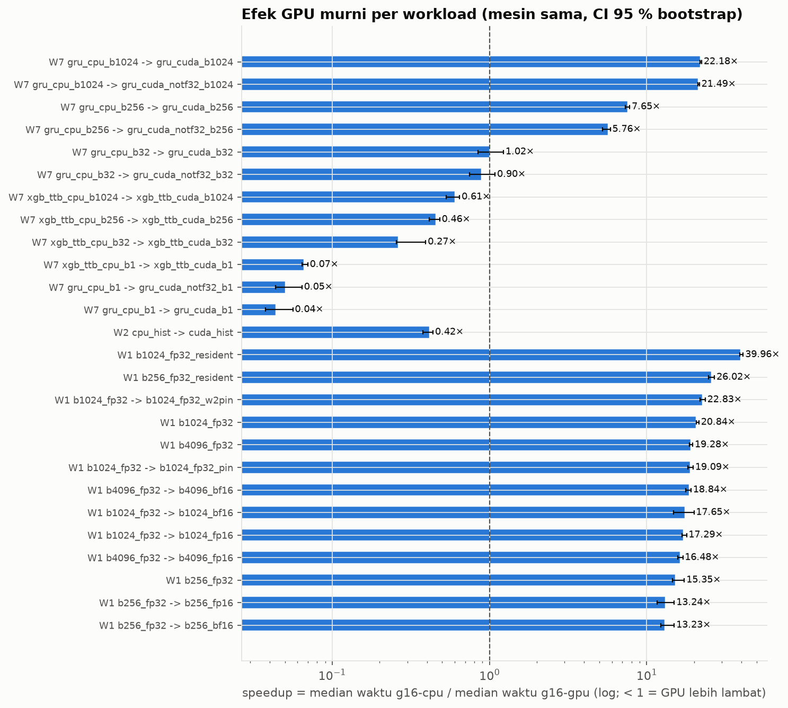
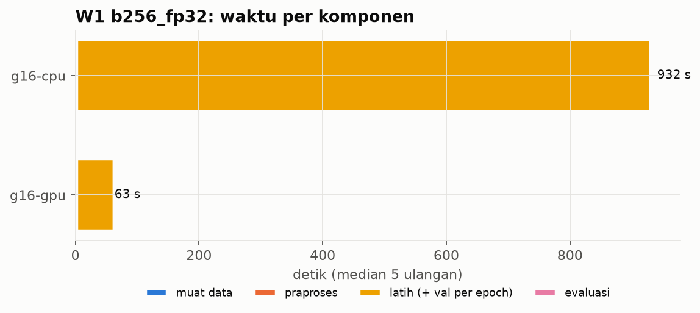
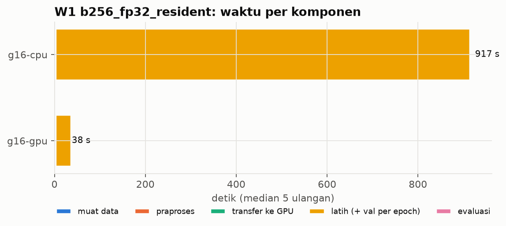
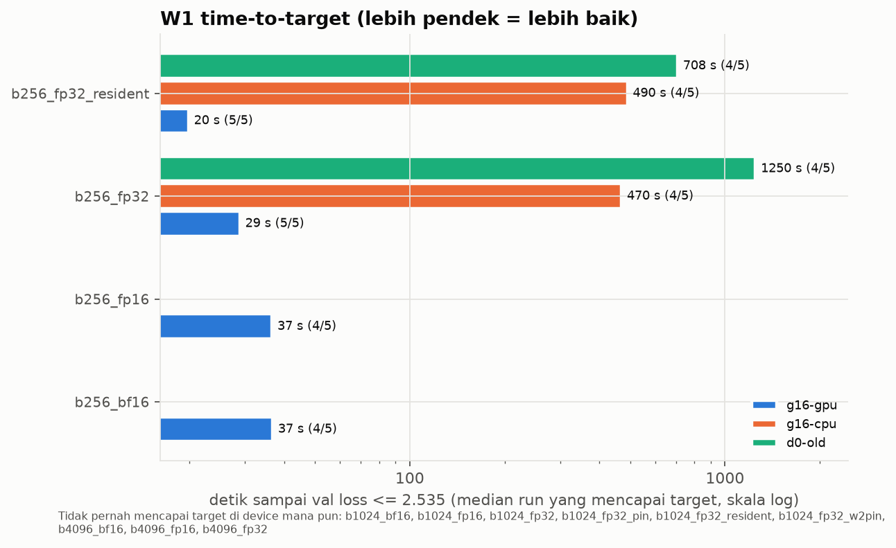
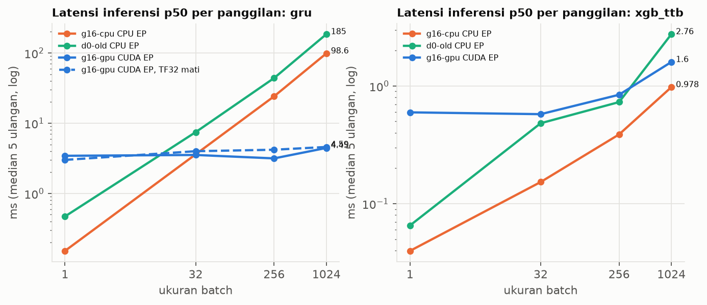
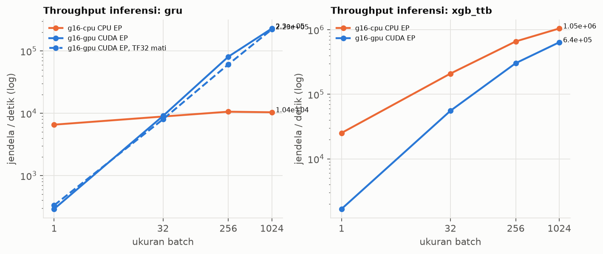
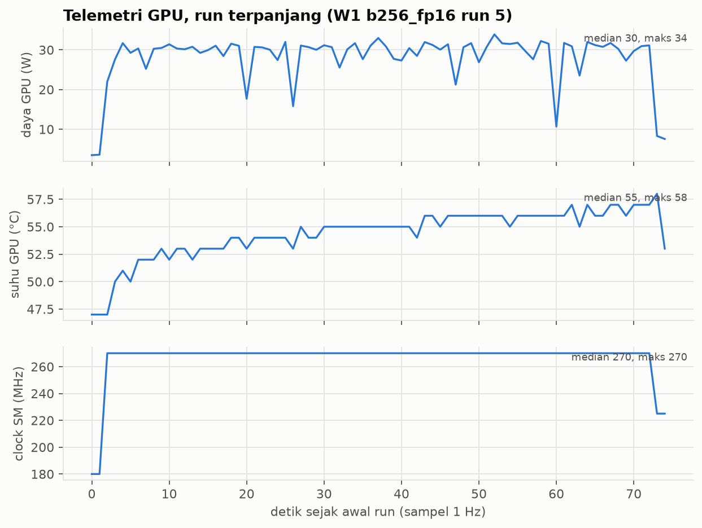

# Laporan latih ulang ColdTrack + benchmark device

> Dibangkitkan oleh `bench/report/build_report.py` pada 2026-10-11T01:51:12+00:00. Jangan diedit manual:
> setiap angka berasal dari JSON di `bench/results/`. Tabel lengkap: `summary.csv`.

## Gerbang G1 (reproduksi)

**Status: lulus dengan catatan** (diputuskan 2026-10-10, user (Tsabita Khoirunnisa), lewat chat Claude Code).
Aturan ketat: acuan val berada dalam mean +/- 2 SD dari lima seed.

### g16-cpu — 6/11 metrik lulus aturan ketat

| model | metrik | mean ± SD (5 seed) | rentang ±2 SD | acuan val | aturan ketat |
|---|---|---|---|---|---|
| gru | forecast_t15_mae_c | 0.1580 ± 0.0021 | [0.1538, 0.1623] | 0.1595 | lulus |
| gru | forecast_t30_mae_c | 0.2085 ± 0.0029 | [0.2028, 0.2143] | 0.2110 | lulus |
| gru | forecast_t60_mae_c | 0.2556 ± 0.0031 | [0.2494, 0.2618] | 0.2554 | lulus |
| gru | macro_f1 | 0.5895 ± 0.0094 | [0.5707, 0.6083] | 0.5800 | lulus |
| gru | akurasi | 0.7990 ± 0.0068 | [0.7855, 0.8126] | 0.7857 | lulus |
| gru | ttb_mae_menit | 22.3346 ± 0.5131 | [21.3085, 23.3608] | 21.2361 | tidak |
| gru | anomali_pr_auc | 0.6924 ± 0.0067 | [0.6790, 0.7059] | 0.6874 | lulus |
| xgb_ttb | ttb_mae_semua_menit | 24.0148 ± 0.0000 | [24.0148, 24.0148] | 25.2174 | tidak |
| xgb_ttb | ttb_mae_le30_menit | 5.1418 ± 0.0000 | [5.1418, 5.1418] | - | tanpa acuan |
| xgb_ttb | ttb_mae_le10_menit | 3.2388 ± 0.0000 | [3.2388, 3.2388] | - | tanpa acuan |
| xgb_clf | macro_f1 | 0.6900 ± 0.0000 | [0.6900, 0.6900] | 0.6916 | tidak |
| xgb_clf | akurasi | 0.8588 ± 0.0000 | [0.8588, 0.8588] | 0.8601 | tidak |
| xgb_clf | anomali_pr_auc | 0.7580 ± 0.0000 | [0.7580, 0.7580] | 0.7546 | tidak |

Sumber: `bench/results/g16-cpu/B1/G1.json`

### g16-gpu — 6/11 metrik lulus aturan ketat

| model | metrik | mean ± SD (5 seed) | rentang ±2 SD | acuan val | aturan ketat |
|---|---|---|---|---|---|
| gru | forecast_t15_mae_c | 0.1593 ± 0.0020 | [0.1553, 0.1633] | 0.1595 | lulus |
| gru | forecast_t30_mae_c | 0.2095 ± 0.0033 | [0.2030, 0.2161] | 0.2110 | lulus |
| gru | forecast_t60_mae_c | 0.2581 ± 0.0064 | [0.2452, 0.2710] | 0.2554 | lulus |
| gru | macro_f1 | 0.5863 ± 0.0049 | [0.5765, 0.5960] | 0.5800 | lulus |
| gru | akurasi | 0.7965 ± 0.0014 | [0.7937, 0.7993] | 0.7857 | tidak |
| gru | ttb_mae_menit | 21.9331 ± 0.5888 | [20.7555, 23.1106] | 21.2361 | lulus |
| gru | anomali_pr_auc | 0.6884 ± 0.0040 | [0.6804, 0.6964] | 0.6874 | lulus |
| xgb_ttb | ttb_mae_semua_menit | 24.0148 ± 0.0000 | [24.0148, 24.0148] | 25.2174 | tidak |
| xgb_ttb | ttb_mae_le30_menit | 5.1418 ± 0.0000 | [5.1418, 5.1418] | - | tanpa acuan |
| xgb_ttb | ttb_mae_le10_menit | 3.2388 ± 0.0000 | [3.2388, 3.2388] | - | tanpa acuan |
| xgb_clf | macro_f1 | 0.6865 ± 0.0000 | [0.6865, 0.6865] | 0.6916 | tidak |
| xgb_clf | akurasi | 0.8580 ± 0.0000 | [0.8580, 0.8580] | 0.8601 | tidak |
| xgb_clf | anomali_pr_auc | 0.7566 ± 0.0000 | [0.7566, 0.7566] | 0.7546 | tidak |

Sumber: `bench/results/g16-gpu/B1/G1.json`

### Alasan "lulus dengan catatan"

- **gru** — GRU tereproduksi: 6 dari 7 metrik lulus per tag, meleset tipis pada metrik yang berbeda di tiap device. Acuan (ml/reports/metrics.json: metrik_val_pembanding) adalah satu run tunggal dari ml/finetune.py yang tidak menyetel seed, sehingga acuan itu sendiri satu sampel acak. Dengan 14 perbandingan (7 metrik x 2 device), 1-2 metrik di luar +/- 2 SD adalah wajar secara kebetulan. Tidak ada metrik yang gagal di kedua device. (sumber: `bench/results/g16-cpu/B1/G1.json`, `bench/results/g16-gpu/B1/G1.json`)
- **xgb_ttb, xgb_clf** — Aturan +/- 2 SD tidak bermakna untuk XGBoost: deterministik (SD 0), dan acuannya basi. XGB_PARAMS tanpa subsample/colsample sehingga seed tidak berpengaruh dan kelima seed identik; aturan +/- 2 SD berubah menjadi 'harus identik'. Acuan ml/reports/baseline_metrics.json terakhir diubah 2026-08-06, sebelum commit 55a30fe (2026-08-13) yang mengubah cara jendela menghitung reefer_duration_min. Builder lama + data v4 mendekati acuan klasifikasi; sisa selisih TTB tidak terjelaskan oleh versi XGBoost 2.1.4-3.2.0 dan versi asli tidak tercatat. (sumber: `bench/results/g16-cpu/B1/G1_investigasi.json`)

Investigasi acuan XGBoost (XGBoost 3.2.0, split val):

| kombinasi | ttb_mae_menit | macro_f1 | akurasi | anomali_pr_auc |
|---|---|---|---|---|
| **acuan baseline_metrics.json** | 25.2174 | 0.6916 | 0.8601 | 0.7546 |
| builder_lama_350cb41+v3 | 24.5883 | 0.4937 | 0.6940 | 0.6785 |
| builder_lama_350cb41+v4 | 24.5883 | 0.6856 | 0.8591 | 0.7564 |
| builder_sekarang+v3 | 24.0209 | 0.4939 | 0.6925 | 0.6797 |
| builder_sekarang+v4 | 24.0209 | 0.6900 | 0.8588 | 0.7580 |

Sumber: `bench/results/g16-cpu/B1/G1_investigasi.json`

**Baseline baru:** Nilai B1 dari pipeline sekarang menjadi baseline pembanding untuk B3 dan G3 (split val). Sumber: `bench/results/g16-cpu/B1/`, `bench/results/g16-gpu/B1/`.

Catatan terbuka: Selisih XGBoost CPU vs GPU pada seed yang sama (classifier) diperiksa di gerbang G2.

## B2: benchmark W1 / W2 / W7

Protokol: 1 pemanasan dibuang + 5 ulangan (seed 1000–1004), median [min–maks]. Kondisi per run tercatat di JSON (`kondisi_manual`, `env`, `telemetri`). `belum diukur` = device belum menjalankan; `tidak berlaku` = varian tidak bermakna di device itu.

### W1: latih GRU (30 epoch, split val)

| config | g16-gpu detik latih | g16-cpu detik latih | d0-old detik latih | F1 val (mean, GPU) | time-to-target GPU |
|---|---|---|---|---|---|
| b1024_bf16 | 45.9 [40.5–54.6] | tidak berlaku | belum diukur | 0.4759 | tidak tercapai (0/5) |
| b1024_fp16 | 46.8 [46.2–48.1] | tidak berlaku | belum diukur | 0.4780 | tidak tercapai (0/5) |
| b1024_fp32 | 38.8 [38.6–39.2] | 809 [807–832] | belum diukur | 0.4751 | tidak tercapai (0/5) |
| b1024_fp32_pin | 42.4 [42–44] | tidak berlaku | belum diukur | 0.4751 | tidak tercapai (0/5) |
| b1024_fp32_resident | 17.7 [17.5–18] | 706 [690–726] | belum diukur | 0.4742 | tidak tercapai (0/5) |
| b1024_fp32_w2pin | 35.5 [34.9–37.1] | tidak berlaku | belum diukur | 0.4751 | tidak tercapai (0/5) |
| b256_bf16 | 70.1 [63.5–73.9] | tidak berlaku | belum diukur | 0.5927 | 37 s (4/5) |
| b256_fp16 | 70.1 [67.1–78.1] | tidak berlaku | belum diukur | 0.5871 | 37 s (4/5) |
| b256_fp32 | 60.5 [57.1–61.7] | 928 [882–1.05e+03] | belum diukur | 0.5863 | 29 s (5/5) |
| b256_fp32_resident | 35.1 [34.3–36.8] | 913 [905–928] | belum diukur | 0.5839 | 20 s (5/5) |
| b4096_bf16 | 47.9 [47.3–51] | tidak berlaku | belum diukur | 0.4715 | tidak tercapai (0/5) |
| b4096_fp16 | 54.8 [53.2–57.4] | tidak berlaku | belum diukur | 0.4723 | tidak tercapai (0/5) |
| b4096_fp32 | 46.8 [46–48] | 902 [883–909] | belum diukur | 0.4710 | tidak tercapai (0/5) |

Sumber: `bench/results/<tag>/W1/<config>/run_*.json`

### Speedup (median pembanding / median yang dibandingkan, CI 95 % bootstrap)

| workload | config | perbandingan | arti | speedup | CI 95 % | G2 |
|---|---|---|---|---|---|---|
| W1 | b1024_fp32 -> b1024_bf16 | g16-cpu → g16-gpu | efek GPU murni (mesin sama) | 17.65× | [14.83, 19.98] | setara |
| W1 | b1024_fp32 -> b1024_fp16 | g16-cpu → g16-gpu | efek GPU murni (mesin sama) | 17.29× | [16.81, 17.92] | setara |
| W1 | b1024_fp32 | g16-cpu → g16-gpu | efek GPU murni (mesin sama) | 20.84× | [20.65, 21.49] | setara |
| W1 | b1024_fp32 -> b1024_fp32_pin | g16-cpu → g16-gpu | efek GPU murni (mesin sama) | 19.09× | [18.33, 19.74] | setara |
| W1 | b1024_fp32_resident | g16-cpu → g16-gpu | efek GPU murni (mesin sama) | 39.96× | [39.01, 41.10] | setara |
| W1 | b1024_fp32 -> b1024_fp32_w2pin | g16-cpu → g16-gpu | efek GPU murni (mesin sama) | 22.83× | [21.79, 23.59] | setara |
| W1 | b256_fp32 -> b256_bf16 | g16-cpu → g16-gpu | efek GPU murni (mesin sama) | 13.23× | [12.31, 14.97] | setara |
| W1 | b256_fp32 -> b256_fp16 | g16-cpu → g16-gpu | efek GPU murni (mesin sama) | 13.24× | [11.61, 14.98] | setara |
| W1 | b256_fp32 | g16-cpu → g16-gpu | efek GPU murni (mesin sama) | 15.35× | [14.58, 17.36] | setara |
| W1 | b256_fp32_resident | g16-cpu → g16-gpu | efek GPU murni (mesin sama) | 26.02× | [24.82, 26.98] | setara |
| W1 | b4096_fp32 -> b4096_bf16 | g16-cpu → g16-gpu | efek GPU murni (mesin sama) | 18.84× | [17.70, 19.14] | setara |
| W1 | b4096_fp32 -> b4096_fp16 | g16-cpu → g16-gpu | efek GPU murni (mesin sama) | 16.48× | [15.73, 16.97] | setara |
| W1 | b4096_fp32 | g16-cpu → g16-gpu | efek GPU murni (mesin sama) | 19.28× | [18.69, 19.61] | setara |
| W2 | cpu_hist -> cuda_hist | g16-cpu → g16-gpu | efek GPU murni (mesin sama) | 0.42× | [0.38, 0.44] | setara |
| W7 | gru_cpu_b1 -> gru_cuda_b1 | g16-cpu → g16-gpu | efek GPU murni (mesin sama) | 0.04× | [0.04, 0.06] | setara |
| W7 | gru_cpu_b1024 -> gru_cuda_b1024 | g16-cpu → g16-gpu | efek GPU murni (mesin sama) | 22.18× | [21.83, 22.38] | setara |
| W7 | gru_cpu_b256 -> gru_cuda_b256 | g16-cpu → g16-gpu | efek GPU murni (mesin sama) | 7.65× | [7.34, 7.79] | setara |
| W7 | gru_cpu_b32 -> gru_cuda_b32 | g16-cpu → g16-gpu | efek GPU murni (mesin sama) | 1.02× | [0.84, 1.23] | setara |
| W7 | gru_cpu_b1 -> gru_cuda_notf32_b1 | g16-cpu → g16-gpu | efek GPU murni (mesin sama) | 0.05× | [0.04, 0.06] | setara |
| W7 | gru_cpu_b1024 -> gru_cuda_notf32_b1024 | g16-cpu → g16-gpu | efek GPU murni (mesin sama) | 21.49× | [21.14, 21.65] | setara |
| W7 | gru_cpu_b256 -> gru_cuda_notf32_b256 | g16-cpu → g16-gpu | efek GPU murni (mesin sama) | 5.76× | [5.23, 5.87] | setara |
| W7 | gru_cpu_b32 -> gru_cuda_notf32_b32 | g16-cpu → g16-gpu | efek GPU murni (mesin sama) | 0.90× | [0.74, 1.08] | setara |
| W7 | xgb_ttb_cpu_b1 -> xgb_ttb_cuda_b1 | g16-cpu → g16-gpu | efek GPU murni (mesin sama) | 0.07× | [0.06, 0.07] | setara |
| W7 | xgb_ttb_cpu_b1024 -> xgb_ttb_cuda_b1024 | g16-cpu → g16-gpu | efek GPU murni (mesin sama) | 0.61× | [0.53, 0.65] | setara |
| W7 | xgb_ttb_cpu_b256 -> xgb_ttb_cuda_b256 | g16-cpu → g16-gpu | efek GPU murni (mesin sama) | 0.46× | [0.41, 0.48] | setara |
| W7 | xgb_ttb_cpu_b32 -> xgb_ttb_cuda_b32 | g16-cpu → g16-gpu | efek GPU murni (mesin sama) | 0.27× | [0.25, 0.39] | setara |

Speedup < 1 berarti yang dibandingkan lebih LAMBAT. Batch besar (b1024/b4096) setara antar-device pada batch yang sama, tetapi kualitasnya di bawah konfigurasi asli b256 dan tidak mencapai target time-to-target: kecepatannya tidak boleh dibaca sebagai percepatan pelatihan model yang sama.

### W2: XGBoost TTB (detik latih)

| config | g16-gpu | g16-cpu | d0-old |
|---|---|---|---|
| cpu_hist | belum diukur | 0.516 [0.501–0.531] | belum diukur |
| cuda_hist | 1.23 [1.18–1.36] | tidak berlaku | belum diukur |

Sumber: `bench/results/<tag>/W2/<config>/run_*.json`

### W7: inferensi ONNX (latensi p50, ms)

| config | g16-gpu | g16-cpu | d0-old |
|---|---|---|---|
| gru_cpu_b1 | belum diukur | 0.152 [0.138–0.193] | belum diukur |
| gru_cpu_b1024 | belum diukur | 98.6 [97–98.9] | belum diukur |
| gru_cpu_b256 | belum diukur | 24.1 [23.6–24.6] | belum diukur |
| gru_cpu_b32 | belum diukur | 3.61 [2.97–4.33] | belum diukur |
| gru_cuda_b1 | 3.44 [3.06–3.74] | tidak berlaku | belum diukur |
| gru_cuda_b1024 | 4.45 [4.41–4.47] | tidak berlaku | belum diukur |
| gru_cuda_b256 | 3.16 [3.1–3.28] | tidak berlaku | belum diukur |
| gru_cuda_b32 | 3.53 [3.09–3.77] | tidak berlaku | belum diukur |
| gru_cuda_notf32_b1 | 3 [2.98–3.49] | tidak berlaku | belum diukur |
| gru_cuda_notf32_b1024 | 4.59 [4.56–4.61] | tidak berlaku | belum diukur |
| gru_cuda_notf32_b256 | 4.19 [4.19–4.62] | tidak berlaku | belum diukur |
| gru_cuda_notf32_b32 | 4 [3.97–4.39] | tidak berlaku | belum diukur |
| xgb_ttb_cpu_b1 | belum diukur | 0.0397 [0.0386–0.0416] | belum diukur |
| xgb_ttb_cpu_b1024 | belum diukur | 0.978 [0.97–0.992] | belum diukur |
| xgb_ttb_cpu_b256 | belum diukur | 0.388 [0.371–0.406] | belum diukur |
| xgb_ttb_cpu_b32 | belum diukur | 0.153 [0.149–0.226] | belum diukur |
| xgb_ttb_cuda_b1 | 0.597 [0.571–0.606] | tidak berlaku | belum diukur |
| xgb_ttb_cuda_b1024 | 1.6 [1.52–1.84] | tidak berlaku | belum diukur |
| xgb_ttb_cuda_b256 | 0.843 [0.827–0.938] | tidak berlaku | belum diukur |
| xgb_ttb_cuda_b32 | 0.576 [0.521–0.59] | tidak berlaku | belum diukur |

Sumber: `bench/results/<tag>/W7/<config>/run_*.json`

## Gerbang G2 (paritas kualitas CPU vs GPU)

**26/26 config setara.** Kriteria ditetapkan sebelum run penuh (`bench/g2_check.py`): W1 selisih mean ≤ rentang antar-seed; W2/W7 selisih relatif ≤ 2%, akurasi ≤ 0.005.
Tidak setara: tidak ada.

Sumber: `bench/results/G2.json`

### Grafik

## B3: latih ulang sesuai PRD (split val)

### Diagnosis baseline

| kelas | F1 GRU (mean 5 seed) | F1 XGBoost | n |
|---|---|---|---|
| A0 | 0.876 | 0.913 | 12325 |
| A1 | 0.586 | 0.617 | 594 |
| A3 | 1.000 | 1.000 | 541 |
| A7 | 0.436 | 0.627 | 545 |
| A8 | 0.332 | 0.348 | 700 |
| degradasi_bertahap | 0.194 | 0.381 | 1122 |
| masalah_sensor | 0.663 | 0.918 | 587 |

| menit sejak onset | 0-10 | 10-30 | 30-60 | 60-120 | 120-inf |
|---|---|---|---|---|---|
| akurasi mode GRU | 0.568 | 0.648 | 0.673 | 0.522 | 0.287 |

Sumber: `bench/results/g16-gpu/B3/diagnosis.json`

### Batas label implisit (dari data, tanpa model)

Label `failure_mode` bertahan dari onset sampai akhir trip, sedangkan A1 (pintu) dan A7 (kejut ambien) adalah peristiwa sementara. Porsi jendela berlabel kelas itu yang tidak memuat jejak peristiwanya:

| kelas | total tanpa jejak | 0-10 | 10-30 | 30-60 | 60-120 | 120-inf | jendela A0 dengan jejak |
|---|---|---|---|---|---|---|---|
| A1 | 58.4% | 0.0% | 0.0% | 0.0% | 60.6% | 100.0% | 0.0% |
| A7 | 50.5% | 0.0% | 0.0% | 0.0% | 44.5% | 100.0% | 0.0% |

Jendela tanpa jejak tidak bisa dibedakan dari jendela sehat oleh model berbasis jendela apa pun; ini membatasi Macro F1 yang dapat dicapai. Definisi metrik dan target TIDAK diubah.
Sumber: `bench/results/g16-gpu/B3/label_check.json`

### Sweep (W3) dan konfirmasi 5 seed + ablation (W4)

- Sweep gru: 60 trial, 71 menit (51 trial/jam, g16-gpu), skor terbaik 0.7540.
- Sweep xgb: 60 trial, 11 menit (336 trial/jam, g16-gpu), skor terbaik 0.7294.

| model | varian | skor mean | rentang | Macro F1 | PR-AUC | forecast t+30 |
|---|---|---|---|---|---|---|
| gru | baseline | 0.6342 | 0.0219 | 0.5839 | 0.6846 | 0.2093 |
| gru | baseline_tanpa_stat | 0.2997 | 1.0302 | 0.4146 | 0.5848 | 0.2348 |
| gru | sweep_top1 | 0.7292 | 0.0393 | 0.6756 | 0.7829 | 0.2088 |
| gru | sweep_top2 | 0.7184 | 0.0451 | 0.6737 | 0.7632 | 0.2088 |
| gru | sweep_top3 | 0.7076 | 0.0909 | 0.6582 | 0.7570 | 0.2075 |
| gru | top1_tanpa_stat | 0.7203 | 0.0260 | 0.6815 | 0.7591 | 0.2121 |
| gru | top1_bobot_asli | 0.6405 | 0.1208 | 0.5774 | 0.7035 | 0.2180 |
| xgb | baseline | 0.7215 | 0.0000 | 0.6865 | 0.7566 | - |
| xgb | sweep_top1 | 0.7247 | 0.0094 | 0.6948 | 0.7545 | - |
| xgb | sweep_top2 | 0.7260 | 0.0041 | 0.6943 | 0.7577 | - |
| xgb | sweep_top3 | 0.7231 | 0.0069 | 0.6887 | 0.7575 | - |

Aturan adopsi (didaftarkan sebelum sweep): kandidat lolos bila skor mean > mean baseline + rentang baseline. Kandidat lolos: {'gru': 'gru/sweep_top1', 'xgb': 'xgb/sweep_top2'}. Untuk XGBoost, baseline deterministik (rentang 0) sehingga selisih sekecil apa pun lolos; kenaikannya tidak berarti secara praktis.
Sumber: `bench/results/g16-gpu/B3/keputusan_kandidat.json`

### Kandidat yang diajukan ke G3

`backend/models/candidates/coldtrack_gru_b3.onnx` (sweep_top1, 254,883 parameter, seed final 1000); paritas ONNX vs PyTorch: OK. Metrik val yang dilaporkan adalah mean 5 seed di tabel atas; metrik model seed 1000 optimistis karena konfigurasinya dipilih memakai seed itu.

| model (CPU EP) | p50 batch 1 (ms) | p50 batch 1024 (ms) |
|---|---|---|
| proposal | 0.170 | 150.7 |
| kandidat_b3 | 1.474 | 464.7 |

Sumber: `bench/results/g16-cpu/B3/latensi_kandidat.json`

## Gerbang G3: split test (dipakai sekali per model)

| metrik (test) | baseline_proposal | kandidat_b3 |
|---|---|---|
| forecast_t15_mae_c | 0.1521 | 0.1565 |
| forecast_t30_mae_c | 0.1976 | 0.1924 |
| forecast_t60_mae_c | 0.2372 | 0.2346 |
| macro_f1 | 0.5807 | 0.6680 |
| akurasi | 0.8134 | 0.8694 |
| anomali_pr_auc | 0.7105 | 0.7862 |
| ttb_mae_semua_menit | 52.4063 | 48.0751 |
| ttb_mae_le10_menit | 3.4301 | 5.1161 |
| ttb_mae_le30_menit | 10.8016 | 12.1569 |

Log akses split test (dicatat sebelum evaluasi; run kedua untuk id yang sama ditolak):

- `baseline_proposal`: ml/reports/coldtrack.onnx (sha256 3948c4476313…), 2026-10-10T22:53:08+00:00, commit 1e668e1
- `kandidat_b3`: backend/models/candidates/coldtrack_gru_b3.onnx (sha256 fab911760e87…), 2026-10-10T22:53:13+00:00, commit 1e668e1
- `b4_berkeley_v1_kesehatan`: ml/sensor_health/artifacts/berkeley_v1_kesehatan.json (sha256 19fbf3cd0220…), 2026-10-11T01:49:41+00:00, commit 073756a

**Keputusan G3: lulus: kandidat B3 diadopsi sebagai model acuan v3** (2026-10-11). Kandidat lebih baik dari baseline di split val (5 seed, aturan adopsi yang didaftarkan sebelum sweep) dan di split test yang dipakai sekali. Forecast tidak memburuk berarti; TTB produksi tetap XGBoost sehingga penurunan head TTB GRU tidak berdampak. Trade-off latensi diterima user: tetap jauh di bawah batas PRD 300 ms per panggilan. Target Macro F1 dan PR-AUC PRD belum tercapai; batasnya dilaporkan (label implisit).

Sumber: `bench/results/test/*.json`, `bench/results/test_access_log.json`

## Gerbang G4: sensor-health Berkeley (mote test, sekali)

**tidak lulus: aturan v0 tetap default, berkeley_v1 tidak diaktifkan** (2026-10-11). H = 24 jam, kriteria dipra-registrasi sebelum data diunduh (`bench/results/keputusan/G4_kriteria.json`, `G4_definisi.json`).

| metrik (mote test) | v0 aturan | berkeley_v1 (kesehatan) |
|---|---|---|
| PR-AUC | 0.422 | 0.876 |
| recall jendela | 0.739 | 1.000 |
| alarm palsu / mote-hari | 0.239 | 0.665 |
| recall kejadian | 1.000 | 1.000 |
| lead time median (menit) | 1434.000 | 1435.000 |

Kriteria: 1_pr_auc_v1_ge_v0_plus_0.05 = ya, 2_alarm_palsu_le_v0_pada_recall_ge_v0 = tidak, G4_lulus = tidak.

- Kriteria 1 terpenuhi: PR-AUC v1 jauh di atas v0 + 0,05 di mote test.
- Kriteria 2 tidak terpenuhi: alarm palsu per mote-hari v1 lebih tinggi dari v0, meski recall v1 lebih tinggi.
- Aturan baterai v0 (< 2,4 V) hampir berimpit dengan definisi kegagalan di data lab (nilai ekstrem hanya muncul saat tegangan < 2,4 V), sehingga v0 adalah pembanding yang sangat kuat di domain ini.
- Hanya 54 kejadian kegagalan (11 di mote test): kekuatan statistik rendah.
- Domain lab (Mica2, bangunan) berbeda dari truk; skema fitur truk tidak memuat tegangan baterai, padahal tegangan adalah sinyal terkuat bagi v0 dan v1.
- Varian dengan level suhu absolut (val PR-AUC lebih tinggi) tidak dipilih karena level suhu lab dapat menjadi penanda kalender.

Sumber: `bench/results/test/b4_berkeley_v1_kesehatan.json`, `bench/results/keputusan/G4.json`
